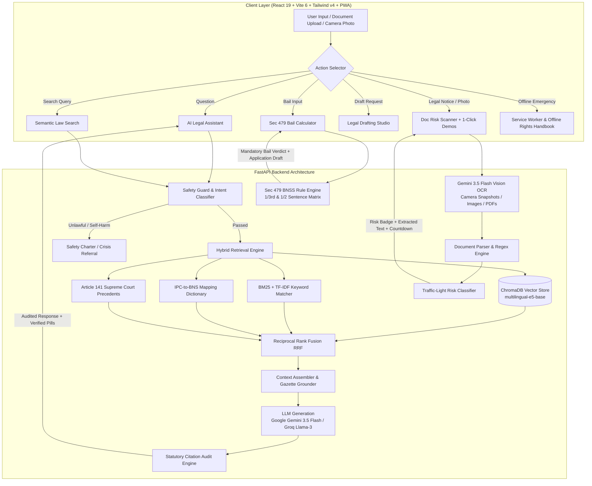

# ⚖️ NyayaSahayak (न्याय सहायक): AI Justice Department Assistant

<p align="center">
  <a href="https://nyaya-sahayak-legal-ai-assistant.vercel.app" target="_blank">
    
  </a>
  
  
  
  
  
  
  
  
  
</p>

> 🌐 **Live Production URL:** [https://nyaya-sahayak-legal-ai-assistant.vercel.app](https://nyaya-sahayak-legal-ai-assistant.vercel.app)

**NyayaSahayak (न्याय सहायक)** is an intelligent, grounded multilingual legal empowerment platform designed to make India's criminal, civil, and constitutional legal framework accessible to every citizen. Developed under university course **AI Foundations (CSE276 CA1 — Project P14)** and aligned with Smart India Hackathon problem statement **SIH1700**, the platform bridges the justice accessibility gap by combining statutory Retrieval-Augmented Generation (RAG), automated document risk auditing, undertrial bail calculations, court-ready complaint drafting, and emergency helpline dispatch in **English, हिन्दी (Hindi), and ਪੰਜਾਬੀ (Punjabi)**.

Unlike generic conversational chatbots, NyayaSahayak operates on a strictly audited, hallucination-resistant architecture: every statutory citation is verified against official Ministry of Law & Justice gazette notifications with an automated **Statutory Audit Grounding Score**.

---

## 📑 Table of Contents

- [✨ Core Capabilities & Platform Features](#-core-capabilities--platform-features)
  - [1. AI Legal Consultation & Statutory Audit](#1-ai-legal-consultation--statutory-audit-assistant)
  - [2. Citizen Legal Action Hub](#2-citizen-legal-action-hub-citizen-empowerment-tools)
    - [A. Section 479 BNSS Undertrial Mandatory Bail Calculator](#a-section-479-bnss-undertrial-mandatory-bail-calculator-bail-calculator)
    - [B. Legal Document Scanner & Risk Analyzer](#b-legal-document-scanner--risk-analyzer-scanner)
    - [C. AI Legal Drafting Studio](#c-ai-legal-drafting-studio-drafting)
    - [D. Interactive Procedural Decision Trees](#d-interactive-procedural-decision-trees-flowcharts)
  - [3. Semantic Law Search & IPC-to-BNS Cross-Walk](#3-semantic-law-search--ipc-to-bns-cross-walk-search)
  - [4. NALSA Section 12 Free Legal Aid Calculator](#4-nalsa-section-12-free-legal-aid-calculator-legal-aid)
  - [5. Bare Acts Explorer & Gazette Verification](#5-bare-acts-explorer--gazette-verification-acts-official)
  - [6. Citizen Support & Grievance Desk](#6-citizen-support--grievance-desk-contact)
  - [7. Privacy, Security & Passwordless Auth](#7-privacy-security--passwordless-auth-auth-dashboard)
  - [8. Progressive Web App (PWA) & Offline Rights Handbook](#8-progressive-web-app-pwa--offline-rights-handbook)
- [🧠 System Architecture & RAG Pipeline](#-system-architecture--rag-pipeline)
- [🛠️ Tech Stack](#️-tech-stack)
- [📂 Project Structure](#-project-structure)
- [🧪 Demo & Test Cases Suite](#-demo--test-cases-suite-demo_test_cases)
- [⚙️ Local Setup & Installation Guide](#️-local-setup--installation-guide)
- [📊 Evaluation, Retrieval Benchmarks & Safety Testing](#-evaluation-retrieval-benchmarks--safety-testing)
- [🔐 Safety Charter & Constitutional Compliance](#-safety-charter--constitutional-compliance)
- [👥 Project Team](#-project-team)

---

## ✨ Core Capabilities & Platform Features

### 1. AI Legal Consultation & Statutory Audit (`/assistant`)
- **Grounded Multilingual QA:** Context-aware legal consultation over the **Bharatiya Nyaya Sanhita, 2023 (BNS)**, **Bharatiya Nagarik Suraksha Sanhita, 2023 (BNSS)**, **Bharatiya Sakshya Adhiniyam, 2023 (BSA)**, Constitution of India, IT Act, POCSO, and civil/commercial laws.
- **Automated Statutory Audit Score:** Every generated answer displays an automated verification pill (e.g. `Statutory Audit: 80% verified citations against official gazettes`) verifying that citations correspond directly to authenticated legal gazettes.
- **Landmark Supreme Court Guidelines (Article 141 Judicial Law):** Enriches statutory text with binding constitutional rulings (*Arnesh Kumar* on Sec 35 BNSS arrest notices, *Lalita Kumari* on mandatory FIR registration, *Satender Kumar Antil* on bail categories, *D.K. Basu* on arrestee rights, *K.S. Puttaswamy* on privacy, and *Dashrath Rupsingh Rathod* on cheque bounce jurisdiction).
- **Interactive Citation Pills:** Clicking any cited provision opens an official snippet card displaying the authentic section text, enactment year, and issuing authority.
- **Voice Readout (TTS):** Integrated speech synthesis reads out legal remedies in English, Hindi, or Punjabi for accessible public use.

### 2. Citizen Legal Action Hub (Citizen Empowerment Tools)

#### A. Section 479 BNSS Undertrial Mandatory Bail Calculator (`/bail-calculator`)
- **2024 Legal Reform Codification:** Codifies the historic 2024 amendment under Section 479 BNSS (replacing old Sec 436A CrPC):
  - **First-time undertrials:** Mandatory entitlement to release on bail after serving **1/3rd** of the maximum statutory term.
  - **Repeat undertrials:** Mandatory release after serving **1/2** of the maximum statutory term.
  - **Capital & life imprisonment offences:** Automatic exclusion flag (discretionary bail only under Sec 480/483).
- **Instructional Placeholders:** Clean, educational placeholders guide citizens on entering statutory maximum punishment without pre-filled assumptions.
- **Automated Court Application Generator:** Pre-populates a ready-to-file Section 479 Bail Application addressed to the competent Chief Judicial Magistrate or Sessions Court.

#### B. Legal Document Scanner & Risk Analyzer (`/scanner`)
- **Camera Image OCR & Gemini Vision:** Direct camera snapshot capture (**"Take Photo of Notice"**) and multi-format upload (`.jpg`, `.jpeg`, `.png`, `.webp`, `.heic`, `.pdf`, `.docx`, `.txt`) powered by **Google Gemini 3.5 Flash Vision** with automatic multi-model fallback.
- **Live Scanning Progress & Auto-Population:** Displays an animated status banner (*"Analyzing Document with AI Vision & Legal Intelligence..."*) while OCR extracts clauses, stamps, and citations, auto-populating transcribed text directly into the review workspace.
- **Traffic-Light Risk Categorization:**
  - 🔴 **High Risk / Danger:** Urgent statutory deadlines, police appearance notices (BNSS Sec 35(3)), or cheque dishonour 15-day countdowns.
  - 🟡 **Medium Risk / Attention:** Complex commercial contracts, lease lock-in clauses, or deposit refund contingencies.
  - 🟢 **Safe / Low Risk:** Mutual settlements, discharge vouchers, and full No-Objection Certificates (NOC).
- **1-Click Demo Photos Gallery:** Built-in interactive drawer featuring 5 authentic demo legal documents with 1-click loading (`⚡ Test This Photo`) and high-resolution camera test links.
- **Academic & Non-Legal Guardrail Banner:** Automatically recognizes and rejects university assignments, resumes, or code with an informative warning, preventing false criminal risk flags.

#### C. AI Legal Drafting Studio (`/drafting`)
- **Structured Legal Notice & Complaint Drafting:** Instant generation of formal legal instruments with step-by-step instructional placeholders:
  - **Zero-FIR Complaints** under Section 173 BNSS (irrespective of police station territorial jurisdiction).
  - **Cheque Dishonour Demand Notices** under Section 138 Negotiable Instruments Act.
  - **Consumer Deficiency Notices** under Consumer Protection Act 2019.
  - **Tenancy Security Deposit Refund Notices** under Tenancy Rights.
- **Isolated Word-Like Print System:** A single click on **"Print / Save as PDF"** prints only the clean formal draft formatted as an official legal brief, completely stripping website navigation, sidebars, and buttons.

#### D. Interactive Procedural Decision Trees (`/flowcharts`)
- Step-by-step visual problem solvers guiding citizens through critical situations:
  - *What to do if Police Arrest You* (Articles 21 & 22; BNSS Sec 35, 47, 48, 58).
  - *Remedies if Police Refuse to Register FIR* (Zero-FIR under Sec 173(1), postal complaint to SP under Sec 173(4), and Magistrate application under Sec 175(3)).
  - *Cheque Dishonour Recovery Roadmap* (Bank memo, 15-day notice, 30-day court limitation).

### 3. Semantic Law Search & IPC-to-BNS Cross-Walk (`/search`)
- **Hybrid Retrieval:** Dense vector retrieval (`intfloat/multilingual-e5-base`) combined with BM25/TF-IDF and act-aware section number parsing.
- **Legacy IPC Cross-Mapping:** Searches querying legacy Indian Penal Code concepts (e.g. "IPC 302 murder" or "IPC 420 cheating") automatically resolve to their corresponding 2023 BNS sections (BNS Section 103 and 318).

### 4. NALSA Section 12 Free Legal Aid Calculator (`/legal-aid`)
- Implements Section 12 of the Legal Services Authorities Act, 1987.
- Automatically calculates entitlement for income-exempt statutory classes: women, children, members of Scheduled Castes and Scheduled Tribes, persons in custody/undertrials, disaster victims, and disabled citizens.
- Evaluates general category citizens against official State Legal Services Authority (SLSA) annual income thresholds across Delhi, Punjab, Maharashtra, Uttar Pradesh, and other states.

### 5. Bare Acts Explorer & Gazette Verification (`/acts`, `/official`)
- **Category-Wise Thematic Classification:** 29+ Acts, Sanhitas, and Rules organized into 10 clean domain categories (Criminal Law & Evidence, Marriage & Family, Traffic & Motor Vehicles, Commercial & Cheque Bounce, Constitutional, Consumer, Labor, Cyber & Tech, Property, Environment).
- **Modern Rounded-3xl UI & Year Badges:** Replaced rectangular tags with high-contrast rounded pill badges (`rounded-full`), category icons, and enactment year indicators.
- **Gazette Verification:** Direct links to official extraordinary Gazette of India notifications and Ministry of Law and Justice repositories (`egazette.gov.in`, `indiacode.nic.in`).

### 6. Citizen Support & Grievance Desk (`/contact`)
- **Live Ticket Generation:** Citizens submitting grievances or inquiries receive an official reference number (e.g. `#NYA-2026-F8A2`) recorded in the database.
- **One-Click Webmail Composer:** Pre-filled draft creation via **Gmail Web** and native email applications.
- **National 24×7 Hotlines:** Click-to-dial access to official government lines: NALSA Legal Aid (`15100`), National Consumer Helpline (`1915`), Cyber Crime Reporting (`1930`), Women in Distress (`181`), and Childline (`1098`).
- **Resilient Offline Architecture:** Incorporates automatic `localStorage` queuing if the backend is temporarily offline, ensuring no citizen inquiry is lost.

### 7. Privacy, Security & Passwordless Auth (`/auth`, `/dashboard`)
- **Google One-Tap GIS & Real-Time Email OTP:** Fast, passwordless access to legal consultation.
- **Client-Side De-Identification:** Scans and removes Aadhaar numbers, phone numbers, and payment details before server submission.
- **Personal Dashboard:** Saves past research queries, statutory citations, and draft history locally to the user's secure account.

### 8. Progressive Web App (PWA) & Offline Rights Handbook
- **Zero-Network Emergency Access:** Fully installable PWA via Service Worker (`sw.js`) and Web App Manifest (`manifest.webmanifest`) on Android, iOS, and desktop browsers.
- **Offline Legal Rights Handbook (`offline.html`):** Provides instant, uninterrupted access to essential citizen rights (Arrest rights under Art 21/22 and Sec 36 BNSS, First-time bail under Sec 479 BNSS, and one-tap emergency hotlines) even when completely disconnected from the internet.

---

## 🧠 System Architecture & RAG Pipeline



---

## 🛠️ Tech Stack

| Layer | Technology | Purpose |
| :--- | :--- | :--- |
| **Frontend Framework** | React 19, Vite 6 | High-speed single-page application with hot module replacement |
| **Styling & Design System** | Tailwind CSS v4 | Custom `@theme static` with high-contrast amber/gold styling and rounded geometry |
| **PWA & Offline Engine** | Service Worker, Web App Manifest | Zero-network offline emergency legal rights handbook and mobile app installability |
| **Icons & Visuals** | Lucide React | Clean, recognizable legal and procedural iconography |
| **Backend API** | FastAPI, Uvicorn | High-throughput asynchronous Python web framework |
| **Embeddings** | `intfloat/multilingual-e5-base` | Multilingual dense vector representations (768-dim) |
| **Vector Database** | ChromaDB | Persistent semantic indexing of 29+ Acts and Supreme Court precedents |
| **Text Retrieval** | Scikit-learn, TF-IDF, Regex | Lexical ranking, title matching, and statutory section extraction |
| **Vision & Image OCR** | Google Gemini 3.5 Flash Vision | Multimodal camera photo transcription and legal stamp extraction |
| **Document Processing** | `python-docx`, `pypdf`, `python-multipart` | Server-side and client-side extraction of Word, PDF, and image notices |
| **Image Synthesis** | Pillow 13.0 (PIL) | Procedural generation of authentic legal documents with stamps & seals |
| **Generative LLMs** | Google Gemini 3.5 Flash, Groq (Llama-3-70B) | High-speed grounded legal reasoning with multi-model fallback |
| **Database** | SQLite3 | Session management, OTP rate-limiting, and grievance ticketing |
| **Authentication** | Google Identity Services (GIS), SMTP OTP | Secure, passwordless authentication |

---

## 📂 Project Structure

```text
NyayaSahayak/
│
├── frontend/                                   # React + Vite Single-Page Application
│   ├── public/                                 # Static PWA assets & offline handbook
│   │   ├── manifest.webmanifest                # Web App Manifest for mobile installation
│   │   ├── sw.js                               # Service Worker for offline asset caching
│   │   ├── offline.html                        # Zero-network Emergency Citizen Rights Handbook
│   │   └── favicon.svg & icons.svg             # Application icons
│   ├── src/
│   │   ├── components/
│   │   │   ├── AnswerBlock.jsx                 # AI responses with high-contrast Statutory Audit pill
│   │   │   ├── BailCalculator.jsx              # Section 479 BNSS Bail Calculator with instructional placeholders
│   │   │   ├── DecisionTrees.jsx               # Interactive procedural decision flows
│   │   │   ├── DocAnalyzer.jsx                 # Camera photo OCR scanner with 1-click demo photo gallery
│   │   │   ├── FirDraftStudio.jsx              # Zero-FIR & notice drafting with isolated clean print
│   │   │   ├── Navbar.jsx                      # Navigation, language switcher & light/dark theme toggle
│   │   │   └── Footer.jsx                      # Disclaimers and compliance footer
│   │   ├── pages/
│   │   │   ├── Assistant.jsx                   # AI Legal Assistant chat interface
│   │   │   ├── CitizenHub.jsx                  # Citizen Action Hub master container
│   │   │   ├── Contact.jsx                     # Grievance desk with ticket generation & Gmail composer
│   │   │   ├── LawSearch.jsx                   # Semantic and section-based law search
│   │   │   ├── LegalAid.jsx                    # NALSA Section 12 free legal aid eligibility calculator
│   │   │   ├── Acts.jsx & OfficialActs.jsx     # Category-wise bare acts reader & Gazette audit
│   │   │   ├── Auth.jsx & Dashboard.jsx        # Google GIS, Email OTP & personal research dashboard
│   │   │   └── SafetyCharter.jsx               # Constitutional compliance & evaluation benchmarks
│   │   ├── api.js                              # Centralized API client with offline fallback handling
│   │   └── index.css                           # Tailwind CSS v4 theme, amber gradients & print styles
│   └── package.json
│
├── backend/                                    # FastAPI Python Backend
│   ├── app/
│   │   ├── main.py                             # API routes: chat, draft, analyze-doc-file (Vision OCR), search
│   │   ├── rag.py                              # Hybrid retrieval: ChromaDB dense search + TF-IDF BM25
│   │   ├── llm.py                              # Gemini 3.5 Flash / Groq client orchestration with statutory audit
│   │   ├── auth.py                             # SQLite user sessions, OTP engine & grievance tickets
│   │   └── safety.py                           # Safety guard: crime block, PII scrub & self-harm help
│   ├── data/
│   │   ├── raw/sc_precedents.csv               # Article 141 Supreme Court Landmark Guidelines
│   │   ├── processed/chunks.jsonl              # Indexed statutory chunks (29+ Acts & Sanhitas)
│   │   ├── chroma/                             # ChromaDB vector store
│   │   └── eval.csv                            # Labelled multilingual evaluation dataset
│   ├── Dockerfile                              # Production container deployment definition
│   └── requirements.txt                        # Python dependencies (python-multipart, pypdf, docx, etc.)
│
├── demo_test_cases/                            # Unified Master Test & Presentation Suite
│   ├── README_DEMO_AND_TEST_CASES.txt          # Master 5-minute presentation & viva guide
│   ├── 01_AI_Legal_Assistant_Test_Cases.txt    # Prompts for RAG, arrest, WhatsApp evidence, audit
│   ├── 02_Semantic_Law_Search_Test_Cases.txt   # Exact section queries & IPC->BNS mappings
│   ├── 03_Bail_Calculator_Test_Cases.txt       # Sec 479 BNSS 1/3rd & 1/2 rule test scenarios
│   ├── 04_Legal_Document_Scanner_Test_Cases.txt# Upload scenarios: urgent summons, cheque, lease, safe
│   ├── 05_AI_Legal_Drafting_Studio_Test_Cases.txt # Zero-FIR, Cheque Notice, isolated print verification
│   ├── 06_Interactive_Problem_Solver_Decision_Trees.txt # Step-by-step citizen procedural paths
│   ├── 07_NALSA_Sec12_Free_Legal_Aid_Test_Cases.txt # Category exemptions & state income thresholds
│   ├── 08_Contact_and_Inquiries_Test_Cases.txt # Ticket generation, form validation, helpline checks
│   ├── 09_Bare_Acts_and_Official_Gazettes_Test_Cases.txt # Category browsing & gazette verification
│   ├── 10_Auth_and_Security_Guardrails_Test_Cases.txt # GIS, OTP, crime refusal & Tele-MANAS crisis
│   ├── Sample Word Documents (.docx):
│   │   ├── 1_Police_Summons_Notice_Sec35_BNSS.docx      (High Risk - 48h Countdown)
│   │   ├── 2_Cheque_Bounce_Notice_Sec138_NI_Act.docx    (High Risk - 15d Countdown)
│   │   ├── 3_Residential_Tenancy_Lease_Agreement.docx   (Medium Risk - Unfair Lock-in)
│   │   ├── 4_Non_Legal_University_Assignment.docx       (Rejection Guardrail Test)
│   │   └── 5_Mutual_Settlement_and_NOC_Receipt.docx     (Safe - Green Shield)
│   └── Realistic Legal Document Photos (.jpg) for Camera & Vision OCR:
│       ├── 1_police_summons_bnss35.jpg         (Police Station seal, FIR ref, Sec 35(5) arrest warning)
│       ├── 2_cheque_bounce_notice_sec138.jpg   (Advocate letterhead, Speed Post barcode, 15-day deadline)
│       ├── 3_unfair_tenancy_agreement.jpg      (e-Stamp certificate, Clause 8 deposit forfeiture)
│       ├── 4_safe_settlement_noc.jpg           (Green full settlement seal, NEFT UTR refund receipt)
│       └── 5_non_legal_assignment.jpg          (University coursework paper for guardrail rejection test)
│
├── scripts/
│   └── make_demo_images.py                     # Python Pillow generator for realistic legal demo photos
│
└── README.md
```

---

## 🧪 Demo & Test Cases Suite (`demo_test_cases/`)

The repository includes a unified [`demo_test_cases/`](demo_test_cases/) folder containing test cases, Word `.docx` documents, and realistic `.jpg` camera photos designed for presentations, live vivas, and automated testing:

| File Name | Target Feature | Core Verification Point |
| :--- | :--- | :--- |
| `1_police_summons_bnss35.jpg` | `/scanner` (Camera OCR) | Sec 35(3) BNSS Police Notice with official seal & Sec 35(5) arrest warning &rarr; 🔴 High Danger. |
| `2_cheque_bounce_notice_sec138.jpg` | `/scanner` (Camera OCR) | Sec 138 NI Act Demand with Speed Post barcode & 15-day cure clock &rarr; 🔴 Critical Danger. |
| `3_unfair_tenancy_agreement.jpg` | `/scanner` (Camera OCR) | Clause 8 with unconditional lock-in forfeiture & power disconnection &rarr; 🟠 Medium Danger. |
| `4_safe_settlement_noc.jpg` | `/scanner` (Camera OCR) | Mutual discharge receipt with NEFT UTR deposit refund confirmation &rarr; 🟢 Safe / Low Risk. |
| `5_non_legal_assignment.jpg` | `/scanner` (Camera OCR) | Academic Deep Learning paper &rarr; Triggers **NON-LEGAL DOCUMENT DETECTED** guardrail alert. |
| `01_AI_Legal_Assistant_Test_Cases.txt` | `/assistant` | Senior citizen arrest safeguard (BNSS 35(7)), WhatsApp chat admissibility (BSA 63), Grounding score. |
| `02_Semantic_Law_Search_Test_Cases.txt` | `/search` | Exact provision lookups ("Section 105 BNSS"), community service penalties (BNS 4(f)). |
| `03_Bail_Calculator_Test_Cases.txt` | `/bail-calculator` | First-time offender 1/3rd sentence calculation (Theft: 12 months) vs repeat offender 1/2 rule. |
| `04_Legal_Document_Scanner_Test_Cases.txt`| `/scanner` | Upload scenarios: urgent summons, cheque bounce, tenancy lease, and rejection test. |
| `05_AI_Legal_Drafting_Studio_Test_Cases.txt` | `/drafting` | Zero-FIR complaint generation and isolated Word-like PDF print without website borders. |
| `06_Interactive_Problem_Solver_Decision_Trees.txt` | `/flowcharts` | Procedural step-by-step decision flows for arrest rights, FIR refusal, and cheque recovery. |
| `07_NALSA_Sec12_Free_Legal_Aid_Test_Cases.txt` | `/legal-aid` | Category exemptions (Women, SC/ST, Custody) and State income thresholds. |
| `08_Contact_and_Inquiries_Test_Cases.txt` | `/contact` | Live ticket generation (`#NYA-2026-XXXX`), input validation, and click-to-dial helplines. |
| `09_Bare_Acts_and_Official_Gazettes_Test_Cases.txt` | `/acts` | Category-wise Act browsing across 10 domains and gazette verification. |
| `10_Auth_and_Security_Guardrails_Test_Cases.txt` | `/auth`, `/charter`| Refusal of crime assistance and compassionate Tele-MANAS (`14416`) referral for self-harm queries. |

---

## ⚙️ Local Setup & Installation Guide

### Prerequisites
- **Python 3.10+**
- **Node.js 18+ and npm**
- **Git**
- **Google Gemini API Key** or **Groq API Key** (optional for local mock fallback)

### 1. Clone the Repository
```powershell
git clone https://github.com/ravnoor-1407/Nyaya-Sahayak-Legal-AI-Assistant.git
cd "Nyaya-Sahayak-Legal-AI-Assistant"
```

### 2. Backend Setup
```powershell
cd backend
python -m venv venv
.\venv\Scripts\Activate.ps1   # On macOS/Linux: source venv/bin/activate
pip install -r requirements.txt
copy .env.example .env        # On macOS/Linux: cp .env.example .env
```

Add your API credentials in `backend/.env`:
```env
GEMINI_API_KEY=your_gemini_api_key_here
GROQ_API_KEY=your_groq_api_key_here
```

Start the FastAPI backend:
```powershell
uvicorn app.main:app --reload --port 8000
```

### 3. Frontend Setup
Open a second terminal window:
```powershell
cd frontend
npm install
npm run dev
```

The application will be accessible at:
- **Frontend:** `http://localhost:5173`
- **Backend Swagger Docs:** `http://localhost:8000/docs`

---

## 📊 Evaluation, Retrieval Benchmarks & Safety Testing

The system includes a labelled evaluation benchmark (`backend/data/eval.csv`) measuring retrieval accuracy and refusal behaviour across 54 multi-domain legal queries:

### Retrieval Performance Matrix

| Metric | Result | Description |
| :--- | :---: | :--- |
| **Hit@1** | **86.7%** | Relevant statutory provision returned as the top result |
| **Hit@3** | **86.7%** | Relevant provision present within the top 3 passages |
| **Hit@5** | **86.7%** | Relevant provision present within the top 5 passages |
| **Mean Reciprocal Rank (MRR)** | **0.867** | High-precision reciprocal rank score |
| **Out-of-Scope Refusal Rate** | **8 / 9 (88.9%)** | Appropriate refusal for non-legal or out-of-jurisdiction queries |

### Hit@3 Accuracy by Language

| Language | Correct / Total | Performance |
| :--- | :---: | :---: |
| **English** | 29 / 31 | **93.5%** |
| **Punjabi (ਪੰਜਾਬੀ)** | 5 / 6 | **83.3%** |
| **Hindi (हिन्दी)** | 5 / 8 | **62.5%** |

### Component Ablation Study

| Retrieval Architecture Component | Hit@3 | MRR |
| :--- | :---: | :---: |
| Baseline (Dense Vector Only) | 51.1% | 0.467 |
| + Keyword & Act-Aware Section Matching | 60.0% | 0.527 |
| + Statutory Title Matching | 77.8% | 0.596 |
| + Legacy IPC-to-BNS Mapping Dictionary | 77.8% | 0.767 |
| **+ Multilingual Translation & Reciprocal Rank Fusion (Final System)** | **86.7%** | **0.867** |

---

## 🔐 Safety Charter & Constitutional Compliance

NyayaSahayak is governed by a **Safety Charter** grounded in the Constitution of India and responsible AI principles:

1. **Article 21 & 39A Realization:** Built to support the constitutional guarantees of speedy justice, undertrial liberty, and free legal aid.
2. **Statutory Non-Advocacy Notice:** Does not establish an advocate-client relationship and does not provide legal representation. Prominent notices advise citizens to seek certified counsel for formal litigation.
3. **Strict Criminal Refusal Guardrails:** Explicitly refuses requests involving the evasion of law enforcement, tampering with evidence, or unlawful conduct.
4. **Client-Side PII Scrubbing:** Sensitive personal identification numbers (Aadhaar, PAN, phone numbers) are scrubbed client-side before transmission.
5. **Mental Health Emergency Intervention:** Detects signs of severe distress or self-harm and immediately provides crisis hotlines including **Tele-MANAS (`14416`)** and KIRAN (`1800-599-0019`).

---

## 👥 Project Team

**Developed under CSE276: AI Foundations (CA1 — Project P14)**  
*Department of Computer Science and Engineering*

| Team Member | Registration / Roll No. | Role & Contribution |
| :--- | :--- | :--- |
| **Ravnoor Kaur** | 12505889 | Project Lead, System Architecture, RAG Pipeline & Full-Stack Development |
| **Adarsh Kumar Shukla** | 12513184 | Legal Knowledge Engineering, Dataset Validation & Evaluation |

---

<p align="center">
  <b>⚖️ NyayaSahayak — न्याय सबके लिए (Justice for All).</b><br>
  <i>Empowering Indian citizens with accurate, accessible, and grounded legal intelligence.</i>
</p>
