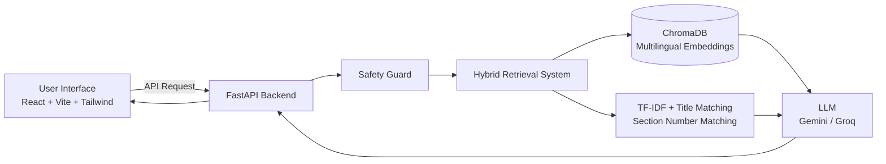

# ⚖️ NyayaSahayak: AI Justice Department Assistant

<p align="center">
  
  
  
  
  
  
  
  
  
  
  
  
</p>

An AI-powered legal information assistant developed as part of the university subject **AI Foundations: CSE276** **CA1 Project (P14)**, thematically aligned with the Smart India Hackathon (SIH) 2024 problem statement **SIH1700**.

**NyayaSahayak** is designed to make Indian legal information more accessible to ordinary citizens through an intelligent, multilingual virtual assistant. Supporting English, Hindi, and Punjabi, the platform helps users explore Indian laws, understand legal provisions, search official Acts, and access essential citizen services.

Unlike a general-purpose chatbot, NyayaSahayak uses a retrieval-based architecture to generate answers from its indexed legal documents. Each response identifies the relevant Act and Section, allowing users to verify the information through official legal sources.

**Note:** NyayaSahayak provides general legal information for educational and informational purposes. It does not replace professional legal advice.

---

## 📚 Prerequisite Knowledge

To understand, modify, or extend this project, familiarity with the following concepts is recommended:

* **Frontend Development (React & JavaScript):**

  * Component-based architecture and reusable UI components.
  * React hooks and state management.
  * Handling API requests and dynamic content rendering.
* **Python & Backend Development:**

  * Python fundamentals, functions, modules, and virtual environments.
  * REST API development using FastAPI.
  * Request handling, response processing, and API integration.
* **Artificial Intelligence & NLP:**

  * Basic understanding of Large Language Models (LLMs).
  * Text embeddings and semantic similarity.
  * Retrieval-Augmented Generation (RAG) concepts.
  * Natural Language Processing and multilingual text processing.
* **Database & Information Retrieval:**

  * Vector databases and similarity search.
  * ChromaDB and TF-IDF-based keyword retrieval.
  * Data preprocessing, document chunking, and indexing.
* **Development Tools:**

  * Visual Studio Code.
  * Git and GitHub.
  * Node.js, npm, and Python package management.

---

## 💻 System & Device Requirements

NyayaSahayak uses a separate frontend and backend architecture. The frontend handles user interactions, while the backend manages legal document retrieval, AI processing, and response generation.

### Software Requirements

| Component           | Requirement                      | Purpose                                     |
| :------------------ | :------------------------------- | :------------------------------------------ |
| Operating System    | Windows, macOS, or Linux         | Development environment                     |
| Code Editor         | Visual Studio Code (Recommended) | Writing and managing source code            |
| Runtime Environment | Python 3.x                       | Backend execution                           |
| JavaScript Runtime  | Node.js and npm                  | Frontend development and package management |
| Web Browser         | Chrome, Firefox, Edge, or Safari | Accessing the application                   |
| API Access          | Gemini API / Groq API            | AI-powered response generation              |
| Internet Connection | Required                         | API communication and model access          |

---

## ✨ Key Features

NyayaSahayak combines AI-powered legal assistance with practical citizen-oriented services.

* **AI-Powered Legal Assistant:**

  * Answers questions related to Indian laws using indexed legal documents.
  * Provides relevant Act names and Section references.
  * Includes read-aloud functionality and voice input.
  * Uses a retrieval-based approach to reduce unsupported responses.

* **Intelligent Legal Search:**

  * Search legal provisions using natural language or Section numbers.
  * Explore relevant legal information through semantic and keyword-based matching.
  * Browse available Indian Acts through a dedicated Acts directory.

* **Official Acts Registry:**

  * Provides access to indexed Indian legislation.
  * Displays issuing authorities, important dates, and source links.
  * Helps users locate relevant legal documents.

* **Citizen Hub:**

  * Provides accessible handbooks covering important citizen-related topics.
  * Includes information about arrest rights, FIR procedures, RTI, consumer protection, and cyber-related matters.

* **Free Legal Aid Eligibility Calculator:**

  * Helps users understand eligibility under Section 12 of the Legal Services Authorities Act.
  * Makes information about free legal aid more accessible.

* **Emergency Helplines & Contact Information:**

  * Provides a directory of important helpline numbers.
  * Offers a dedicated contact page for users.

* **Multilingual Interface:**

  * Supports English, Hindi, and Punjabi.
  * Helps users interact with the platform in their preferred language.

* **Interactive User Interface:**

  * Dashboard displaying live usage information.
  * Light and dark themes.
  * Responsive interface for convenient navigation.

* **AI Safety Charter:**

  * Explains the platform's safety principles.
  * Provides information about evaluation results and responsible AI usage.

---

## 🧠 System Architecture

NyayaSahayak follows a frontend-backend architecture that combines semantic retrieval, keyword matching, vector search, and Large Language Models.

### Architecture Diagram



### How the System Works

**1. Document Processing & Indexing**

* Legal documents are collected from the selected datasets and official government sources.
* Acts are divided into smaller sections or articles.
* Each passage retains its corresponding Act and Section information.
* Text passages are converted into numerical embeddings using `intfloat/multilingual-e5-base`.
* The generated embeddings are stored in ChromaDB for semantic retrieval.

**2. Hybrid Information Retrieval**

When a user submits a legal question, the backend searches the indexed knowledge base using multiple techniques:

* Dense vector search for semantic similarity.
* TF-IDF keyword matching.
* Section-number matching based on the Act mentioned by the user.
* Title matching for improved document identification.
* IPC-to-BNS mapping expansion for handling older legal references.
* Query translation into English to support Hindi and Punjabi searches.

**3. AI Response Generation**

* Relevant legal passages are provided to the Large Language Model.
* Gemini or Groq is used for generating responses, with fallback support.
* The model is instructed to answer using the retrieved legal information.
* Relevant Act and Section references are included in the response.
* If the retrieved information is insufficient, the assistant can decline to provide an answer.

**4. Response Delivery**

The generated response is returned through FastAPI to the React frontend, where users can read, interact with, or listen to the response.

---

## 🛠️ Tech Stack

The project combines modern frontend technologies, Python backend development, information retrieval techniques, and generative AI services.

| Category               | Technologies                              |
| :--------------------- | :---------------------------------------- |
| Frontend Framework     | React                                     |
| Build Tool             | Vite                                      |
| Styling                | Tailwind CSS v4                           |
| Charts & Visualization | Recharts                                  |
| Icons                  | Lucide React                              |
| Backend Framework      | FastAPI                                   |
| Programming Language   | Python                                    |
| Embedding Model        | multilingual-e5-base                      |
| Vector Database        | ChromaDB                                  |
| Machine Learning / NLP | Sentence Transformers, Scikit-learn       |
| Information Retrieval  | TF-IDF, Semantic Search, Hybrid Retrieval |
| Large Language Models  | Google Gemini API, Groq API               |
| Data Storage           | CSV, PDF, JSON                            |
| Development Tools      | VS Code, Git, GitHub                      |

---

## 📂 Project Structure

The project is organized into separate frontend and backend components to maintain modularity and simplify development.

```text
NyayaSahayak/
│
├── frontend/
│   ├── src/
│   │   └── React application source files
│   ├── package.json
│   └── vite.config.js
│
├── backend/
│   ├── app/
│   │   └── main.py
│   │
│   ├── data/
│   │   ├── eval.csv
│   │   └── eval_results.json
│   │
│   ├── scripts/
│   │   ├── build_chunks
│   │   ├── ingest
│   │   ├── train_topic
│   │   └── evaluate
│   │
│   ├── requirements.txt
│   └── .env.example
│
└── README.md
```

*Note: This is a simplified representation of the project structure, highlighting the main directories and files referenced in the setup and evaluation workflow.*

---

## ⚙️ How to Run the Project

Follow these steps to configure and run NyayaSahayak locally.

### Prerequisites

Before starting, ensure that the following are installed:

1. Python 3.x
2. Node.js and npm
3. Visual Studio Code
4. Git
5. Gemini API Key and/or Groq API Key

### (A) Backend Setup

**Step 1: Navigate to the backend directory**

```powershell
cd backend
```

**Step 2: Create a Python virtual environment**

```powershell
python -m venv venv
```

**Step 3: Activate the virtual environment**

```powershell
.\venv\Scripts\Activate.ps1
```

**Step 4: Install the required dependencies**

```powershell
pip install -r requirements.txt
```

**Step 5: Configure environment variables**

```powershell
copy .env.example .env
```

Open the `.env` file and add your API keys:

```env
GEMINI_API_KEY=your_gemini_api_key
GROQ_API_KEY=your_groq_api_key
```

**Step 6: Prepare and process the legal documents**

Execute the following commands:

```powershell
python -m scripts.build_chunks
python -m scripts.ingest
python -m scripts.train_topic
```

**Step 7: Start the FastAPI backend server**

```powershell
uvicorn app.main:app --reload --port 8000
```

### (B) Frontend Setup

Open a second terminal in Visual Studio Code.

**Step 1: Navigate to the frontend directory**

```powershell
cd frontend
```

**Step 2: Install frontend dependencies**

```powershell
npm install
```

**Step 3: Start the development server**

```powershell
npm run dev
```

### (C) Access the Application

Once both servers are running:

| Component            | Local Address           |
| :------------------- | :---------------------- |
| Frontend Application | `http://localhost:5173` |
| Backend API          | `http://localhost:8000` |

Open the frontend address in your browser to access NyayaSahayak.

**Important:** Wait until the backend terminal displays `Application startup complete.` before testing the application. The embedding model requires some time to load during initialization.

---

## 📊 Data Sources & Licences

The knowledge base is developed using legal datasets and official Indian government publications.

| Dataset / Document                           | Purpose                            | Source                 | Licence / Terms                |
| :------------------------------------------- | :--------------------------------- | :--------------------- | :----------------------------- |
| Bharatiya Nyaya Sanhita (BNS) Sections - CSV | Legal knowledge base               | Kaggle                 | Check original dataset licence |
| IPC to BNS Mapping - CSV                     | Legal reference mapping            | Kaggle                 | Check original dataset licence |
| Constitution of India - PDF                  | Constitutional information         | Legislative Department | Government publication         |
| BNSS 2023                                    | Criminal procedure information     | India Code             | Government publication         |
| BSA 2023                                     | Evidence-related legal information | India Code             | Government publication         |
| Information Technology Act 2000              | Cyber law information              | India Code             | Government publication         |
| Consumer Protection Act 2019                 | Consumer rights information        | India Code             | Government publication         |
| `backend/data/eval.csv`                      | Model retrieval evaluation         | Developed by the team  | Original team work             |

### Data Verification

* A sample of the Kaggle dataset entries was cross-checked against official India Code publications.
* Official government publications are treated as the authoritative reference.
* Since legislation can be amended over time, users should always verify legal provisions against the latest official text.

**Official Legal Resources:**

* [India Code](https://www.indiacode.nic.in/)
* [Legislative Department](https://legislative.gov.in/)

*Note: Insert the exact Kaggle dataset names, source URLs, and licence details before publishing the final README. These details were not specified in the original project documentation.*

---

## 📈 Evaluation & Performance Metrics

The project includes a labelled evaluation dataset to measure the retrieval system's ability to identify relevant legal information.

### Evaluation Dataset

The evaluation dataset is stored in:

`backend/data/eval.csv`

It contains:

* 45 in-scope questions across English, Hindi, and Punjabi.
* 9 out-of-scope questions to test the assistant's refusal behaviour.

To execute the evaluation:

```powershell
python -m scripts.evaluate
```

The evaluation results are saved in:

`backend/data/eval_results.json`

They are also displayed on the AI Safety Charter page.

### Retrieval Performance

| Evaluation Metric              | Result |
| :----------------------------- | :----: |
| Hit@1                          |  86.7% |
| Hit@3                          |  86.7% |
| Hit@5                          |  86.7% |
| Mean Reciprocal Rank (MRR)     |  0.867 |
| Out-of-Scope Questions Refused |  8 / 9 |

### Hit@3 Performance by Language

| Language | Correct Retrievals | Performance |
| :------- | :----------------: | :---------: |
| English  |       29 / 31      |     94%     |
| Hindi    |        5 / 8       |     62%     |
| Punjabi  |        5 / 6       |     83%     |

### Retrieval Ablation Study

The following comparison demonstrates how different retrieval components contributed to the overall system performance.

| Configuration                                    | Hit@3 |  MRR  |
| :----------------------------------------------- | :---: | :---: |
| Original Baseline (Before Title-Column Fix)      | 57.8% | 0.503 |
| A. Vector Search Only                            | 51.1% | 0.467 |
| B. Keyword + Act-Aware Section Matching          | 60.0% | 0.527 |
| C. Addition of Title Matching                    | 77.8% | 0.596 |
| D. Addition of IPC-to-BNS Mapping Expansion      | 77.8% | 0.767 |
| E. Addition of Hindi & Punjabi Query Translation | 86.7% | 0.867 |

### Safety Testing

The project also includes a dedicated safety testing script:

```powershell
python -m scripts.test_safety
```

The safety tests cover:

* Requests involving destruction of evidence or document forgery.
* Self-harm-related messages and support helpline responses.
* Emergency-related phrases and the addition of a 112 emergency notice.
* Prompt-injection attempts and attempts to bypass system instructions.

**Important:** These evaluation results measure retrieval performance on the team's labelled dataset. They should not be interpreted as proof of 86.7% legal-answer accuracy. The dataset is relatively small and does not represent every possible legal question.

---

## 🔐 Safety & Privacy

Responsible AI usage and user safety are important aspects of NyayaSahayak.

The application incorporates several safety mechanisms:

* **Source-Based Responses:** Answers are generated using retrieved legal information rather than unrestricted general knowledge.
* **Legal Disclaimer:** Responses include a disclaimer clarifying that the platform provides legal information, not professional legal advice.
* **Restricted Requests:** Crime-assistance requests are blocked.
* **Prompt-Injection Protection:** Attempts to manipulate the assistant into ignoring its instructions are refused.
* **Sensitive Information Protection:** Phone numbers, email addresses, and identification numbers are removed before questions are logged.
* **Emergency Awareness:** Emergency-related phrases trigger an appropriate 112 notice.
* **Contact Form Privacy:** The contact form opens the visitor's own email application and does not store submitted information.

---

## ⚠️ Limitations

Although NyayaSahayak provides an accessible way to explore legal information, the current implementation has certain limitations:

* **Not Legal Advice:** The platform provides general legal information and cannot replace consultation with a qualified legal professional.
* **Limited Knowledge Base:** Currently, only six Acts are indexed.
* **API Rate Limits:** Free-tier Gemini and Groq API limits may occasionally slow down or interrupt response generation.
* **Document Processing:** Extracted text from PDFs and CSV datasets may contain formatting or parsing errors.
* **Evaluation Dataset:** The evaluation dataset is relatively small and was labelled by the development team.
* **Optimistic Refusal Results:** The refusal threshold was tuned using the same evaluation questions, so the refusal results may be optimistic.
* **Multilingual Performance:** Hindi and Punjabi retrieval depend on query translation, and Punjabi response quality may vary depending on the selected LLM.

---

## 🚀 Future Scope

The project can be further improved through the following developments:

* **Expanded Legal Knowledge Base:** Integrate more Indian Acts, including RTI and the Legal Services Authorities Act.
* **Court Judgments & Case Laws:** Include relevant court judgments to provide broader legal context.
* **Additional Indian Languages:** Extend multilingual support to more regional languages.
* **Improved Evaluation:** Develop a separate held-out evaluation dataset for more reliable performance measurement.
* **Enhanced Voice Interaction:** Improve voice-based interaction for users with limited literacy or difficulty navigating text-heavy interfaces.
* **Improved Retrieval Accuracy:** Further optimize semantic search, document matching, and multilingual retrieval.

---

## 🤝 Contributing

NyayaSahayak is an academic project developed to explore the practical application of Artificial Intelligence in improving access to legal information.

Suggestions, code improvements, and feature enhancements are welcome.

To contribute:

1. Fork the repository.

2. Create a separate feature branch:

   ```bash
   git checkout -b feature/YourFeatureName
   ```

3. Implement and test your changes.

4. Commit your changes:

   ```bash
   git commit -m "Add: YourFeatureDescription"
   ```

5. Push your branch and submit a Pull Request.

---

## 👥 Project Team

**Developed as part of CSE276 CA1 – Project P14**

| Team Member         | Student ID |
| :------------------ | :--------- |
| Ravnoor Kaur        | 12505889   |
| Adarsh Kumar Shukla | 12513184   |

---

## 👤 Author

**Ravnoor Kaur**

---

<p align="center">
  <b>⚖️ NyayaSahayak — Making Legal Information More Accessible Through AI.</b>
  <br>
  Built with the vision of simplifying access to justice through technology.
</p>
