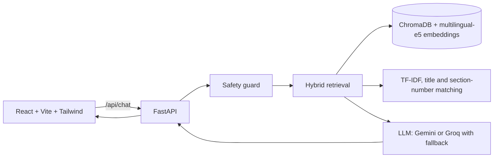

# NyayaSahayak: AI Justice Department Assistant

CSE276 CA1 project (P14). Thematically aligned with SIH 2024 problem statement
SIH1700, an AI chatbot / virtual assistant for the Department of Justice.

NyayaSahayak is a multilingual (English, Hindi, Punjabi) legal information
assistant. It answers questions about Indian law using only indexed statutes,
and every answer names the Act and section it came from so a citizen can check
it. It is legal information, not legal advice.

Team (from the project list): ZJ14, Ravnoor Kaur (12505889),
Adarsh Kumar Shukla (12513184).

## Features

- AI Legal Assistant with citations, read-aloud and voice input
- Law Search (by meaning or section number) and an Acts browser
- Official Acts registry with issuing authority, dates and source links
- Citizen Hub handbooks (arrest rights, FIR, RTI, consumer, cyber)
- Free Legal Aid eligibility calculator (Section 12, Legal Services Authorities Act)
- Helplines directory, Contact page, Dashboard with live usage, AI Safety Charter
- English, Hindi and Punjabi interface, light and dark themes

## Architecture



1. **Indexing.** Acts are split by Article or Section so each passage keeps its
   number, then embedded with `intfloat/multilingual-e5-base` into ChromaDB.
2. **Retrieval.** Dense search, TF-IDF keyword search, section-number matching
   (aware of which Act the user named), title matching, and IPC-to-BNS mapping
   expansion. Hindi and Punjabi questions are also translated to English for
   retrieval.
3. **Generation.** The LLM is told to answer only from the retrieved passages
   and to cite them. If nothing is close enough, the assistant declines.

## Tech stack

React, Vite, Tailwind CSS v4, Recharts, lucide-react | FastAPI, Python,
sentence-transformers, ChromaDB, scikit-learn | Gemini and Groq free-tier APIs.

## Setup (Windows PowerShell)

```powershell
# backend
cd backend
python -m venv venv
.\venv\Scripts\Activate.ps1
pip install -r requirements.txt
copy .env.example .env      # then add your GEMINI_API_KEY and GROQ_API_KEY
python -m scripts.build_chunks
python -m scripts.ingest
python -m scripts.train_topic
uvicorn app.main:app --reload --port 8000

# frontend (second terminal)
cd frontend
npm install
npm run dev
```

Open http://localhost:5173. Wait for "Application startup complete." in the
backend terminal first, because the embedding model takes a moment to load.

## Data sources and licences

| Data | Used for | Source | Licence / terms |
|---|---|---|---|
| Bharatiya Nyaya Sanhita sections (CSV) | Knowledge base | Kaggle: <dataset name and URL> | <licence on the Kaggle page> |
| IPC to BNS mapping (CSV) | Knowledge base | Kaggle: <dataset name and URL> | <licence on the Kaggle page> |
| Constitution of India (PDF) | Knowledge base | legislative.gov.in | Government of India publication |
| BNSS 2023, BSA 2023, IT Act 2000, Consumer Protection Act 2019 (PDF) | Knowledge base | indiacode.nic.in | Government of India publication |
| `backend/data/eval.csv` | Evaluation | Written by the team | Own work |

A sample of the Kaggle rows was cross-checked against India Code. Statutes are
amended over time, so the official text always prevails.

## Evaluation

Labelled question set in `backend/data/eval.csv`: 45  in-scope questions in
English, Hindi and Punjabi, plus 9 out-of-scope questions. Run
`python -m scripts.evaluate`; results are saved to `backend/data/eval_results.json`
and shown on the Safety Charter page.

| Metric | Result |
|---|---|
| Hit@1 | 86.7% |
| Hit@3 | 86.7% |
| Hit@5 | 86.7% |
| MRR | 0.867 |
| Out-of-scope refused | 8 / 9 |

Hit@3 by language: English 29/31 = 94%, Hindi 5/8 = 62%%, Punjabi 5/6 = 83%.

Retrieval ablation (each row adds one component):

| Configuration | Hit@3 | MRR |
|---|---|---|
| Original baseline (before the title-column fix) | 57.8% | 0.503 |
| A. Vector search only | 51.1% | 0.467 |
| B. + keyword and act-aware section matching | 60.0% | 0.527 |
| C. + title matching | 77.8% | 0.596 |
| D. + IPC-to-BNS mapping expansion | 77.8% | 0.767 |
| E. + query translation for Hindi and Punjabi | 86.7% | 0.867 |

Safety tests (`python -m scripts.test_safety`): requests to destroy evidence or
forge documents are declined, self-harm messages get support helplines,
emergency phrases add a 112 notice, and prompt-injection attempts are refused.

## Safety and privacy

Crime-assistance requests are blocked, answers use only retrieved sources,
phone numbers, emails and ID numbers are removed before a question is logged,
and every answer carries a disclaimer. The Contact form opens the visitor's own
email app and stores nothing.

## Limitations

- General legal information, not legal advice.
- Free-tier LLM rate limits can slow or interrupt answers.
- Section text from PDFs and CSVs may contain parsing errors.
- The evaluation set is small, was labelled by the team, and the refusal
  threshold was tuned on the same questions, so refusal results are optimistic.
- Hindi and Punjabi retrieval depends on query translation; Punjabi answer
  quality varies with the LLM.
- Only six Acts are indexed.

## Future work

Court judgments and case law, more Acts (RTI, Legal Services Authorities Act),
more Indian languages, a held-out evaluation set, and voice mode for
low-literacy users.